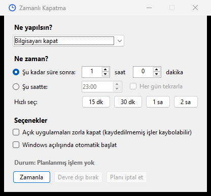

# Scheduled Shutdown (Zamanlı Kapatma)

[Türkçe](README.md) | **English**

A small Windows app that shuts down, restarts or puts your computer to sleep after a set time or at a set clock time. It runs in the notification area on the right side of the taskbar.

**[Download ZamanliKapatma.exe](https://github.com/uslumehmet/ZamanliKapatma/releases/latest/download/ZamanliKapatma.exe)** · Windows 10 / 11 · No installation needed



## What can it do?

- Schedule "shut down in 1 hour" or "shut down at 23:00"
- Shut down, restart, sleep or sign out
- Repeat every day at the same time
- Pause and resume the timer by right-clicking the icon
- A warning one minute before the action (to snooze or cancel)
- Turkish and English interface (right-click the icon → **Dil / Language**)

## Usage

Download the exe and double-click it. Everything the app needs is inside the file, so there is nothing else to install.

In the window, choose what should happen and when, then click **Schedule**. Closing the window keeps the app running in the notification area. To quit completely, right-click the icon and choose **Exit**.

On first launch Windows may show a "Windows protected your PC" message. The app is not code-signed, so you can get past it with **More info → Run anyway**.

## Development

Written in C# with .NET 10 (WinForms). Building the code requires the [.NET 10 SDK](https://dotnet.microsoft.com/download). It is not needed to use the app.

```
dotnet run --project src/ZamanliKapatma
dotnet test
```

- `src/ZamanliKapatma`: windows and the tray icon
- `src/ZamanliKapatma.Core`: scheduling logic
- `tests`: unit tests

## License

[MIT](LICENSE)
