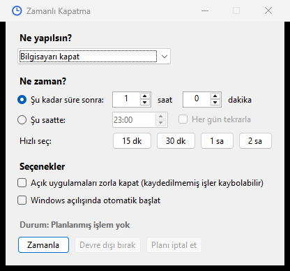

# Zamanlı Kapatma

Bilgisayarı belirli bir süre sonra ya da belirli bir saatte kapatan, yeniden başlatan veya uyku moduna alan küçük bir Windows uygulaması. Görev çubuğunun sağındaki simge alanında çalışır.

**[ZamanliKapatma.exe'yi indir](https://github.com/uslumehmet/ZamanliKapatma/releases/latest/download/ZamanliKapatma.exe)** · Windows 10 / 11 · Kurulum gerekmez



## Neler yapabiliyor?

- "1 saat sonra kapat" ya da "23:00'te kapat" gibi zamanlama
- Kapatma, yeniden başlatma, uyku ve oturumu kapatma
- Her gün aynı saatte tekrarlama
- Simgeye sağ tıklayarak zamanlayıcıyı durdurma ve yeniden başlatma
- İşlemden 1 dakika önce uyarı (ertelemek veya iptal etmek için)

## Kullanım

Exe'yi indirip çift tıklamanız yeterli. Uygulamanın çalışması için gereken her şey dosyanın içinde, ayrıca bir şey kurmanız gerekmiyor.

Açılan pencerede ne yapılacağını ve ne zaman yapılacağını seçip **Zamanla**'ya basın. Pencereyi kapatsanız da uygulama simge alanında çalışmaya devam eder. Tamamen kapatmak için simgeye sağ tıklayıp **Çıkış**'ı seçin.

İlk açılışta Windows "Windows bilgisayarınızı korudu" uyarısı gösterebilir. Uygulama imzalı olmadığı için çıkan bu uyarıyı **Ek bilgi → Yine de çalıştır** ile geçebilirsiniz.

## Geliştirme

C# ve .NET 10 (WinForms) ile yazıldı. Kodu derlemek için [.NET 10 SDK](https://dotnet.microsoft.com/download) gerekir. Uygulamayı kullanmak için gerekmez.

```
dotnet run --project src/ZamanliKapatma
dotnet test
```

- `src/ZamanliKapatma`: pencereler ve simge alanı
- `src/ZamanliKapatma.Core`: zamanlama mantığı
- `tests`: birim testleri

## Lisans

[MIT](LICENSE)
